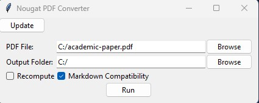

# Nougat-GUI

A user-friendly GUI for [Nougat](https://github.com/facebookresearch/nougat), a tool by Facebook Research that converts academic PDFs into markdown files.

## Features
- **OCR & AI**: Converts academic PDFs into markdown. This is still a work in development.
- **Markdown Compatibility**: Renders tables and formulas in Mathpix Markdown format.
- **Self-installs Nougat**: If the app does not detect Nougat, it installs it automatically.
- **Link to install PyTorch**: PyTorch improves performance. If the app does not detect PyTorch, it shows a download link.
- **Update button**: Nougat and NougatGUI are in development. The Update button keeps you up to date.

## How to Use
1. **Install [Python](https://www.python.org/downloads/)**
2. **Download the [NougatGUI.py](https://github.com/sm18lr88/Nougat-GUI/blob/main/NougatGUI.py) file**
3. **Run**: Open a terminal and run `python NougatGUI.py`. If Nougat is not installed yet, give the app some time to install it.
4. **Optimization**: For faster performance, install PyTorch. Click the link in the app to open the PyTorch install page.
5. **Output**: Choose markdown compatibility for .mmd files. You can open them as a regular .md or .txt file.
6. **Error Handling**: Use "Recompute" to make the app work on the file again and ignore data from previous attempts.

Learn more about [Nougat](https://github.com/facebookresearch/nougat).

### License:
- Respect Nougat and its license:
  - The Nougat codebase is licensed under MIT.
  - The Nougat model weights are licensed under CC-BY-NC.
